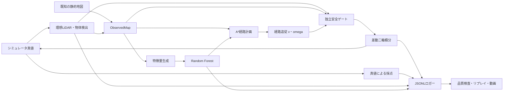
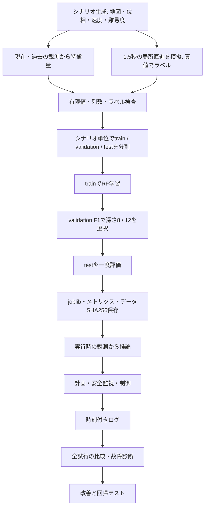

# 設計・検証基準（v2）

## 選定と構成

CPU上のPython 3.12簡易2Dシミュレーションを採用。NumPy、scikit-learn RandomForestClassifier、Matplotlib Agg、FFmpegを利用し、GPU・GUI・外部APIを必要としない。ROS 2は導入していないが、センサー・推論・計画・制御・安全監視・記録を分離する設計思想を適用した。

## データフローとMLOps / RobOps

全て独自のPython実装。講義資料・配布ノートブック・サンプルコードを複製していない。収集、品質検査、モデル選択、推論、制御、ログ再生を小さな部品へ分離し、講義のMLOps/RobOpsの概念を再現可能な処理系列として応用した。

## 環境とインターフェース

25×20セル、1セル1m。基地(2,10)、避難所(22,10)。壁と瓦礫は単位正方形、移動物体は半径0.32mの円。basicは幅のある通路、shortcutは狭い短路と広い迂回路、dynamicは6秒で短路が封鎖され、別の移動物体も存在する。unreachableは検査用の到達不能環境。easy/normal/hardで瓦礫数を変える。学習用は壁位置・隙間位置も変える。移動物体の位相と周波数はシードから固定する。物体がロボットを避ける規則はなく、両方式で同一の外生的な位置関数を使用する。

ロボット状態は(x,y,theta,v,omega)、入力は(v_cmd,omega_cmd)。車輪間隔0.40m、半径0.20m。左右車輪速度はv±omega×車輪間隔/2に対応し、同じ差動二輪運動学を円弧として積分する。横滑り・瞬間移動はない。configs/default.jsonに刻み0.1s、最大速度0.9m/s、最大角速度2rad/s、最大加速度1m/s²、角加速度4rad/s²を定義した。安全停止だけは加速度制約より優先する理想ブレーキであり、実機停止距離を保証するものではない。

センサーは32本・全周・最大5mの解析的なレイキャスト。静的正方形と円の最初の交点を返す。命中した動的物体の中心・半径・IDを理想的に分類できる仮定を置き、過去の検出差分で速度を推定する。レイに当たらない物体や壁の向こうの物体は観測しない。物体検出そのものに別のAIは使っていない。初期の静的地図と自己位置は既知とし、新しい壁は観測した命中セルだけをObservedMapに追加する。

world.pyが真値を保持する一方、planner/features/safetyにはObservedMapと観測を渡す。型検査でWorldの誤投入を拒否する。未来の位置関数は学習ラベルと評価器のみが利用する。観測速度からの等速予測と真の未来位置は区別する。

## 特徴量とラベル

|特徴量|意味・単位|
|---|---|
|static_clearance_m|既知地図における候補中心から壁表面の最短距離m|
|passage_width_m|候補方向の左右地図レイ距離合計m（各側最大5m）|
|observed_mover_distance_m|現在観測された物体のうち候補に最も近い中心までの距離m。なし=10m|
|estimated_closing_mps|観測物体の過去差分速度と候補速度からの接近速度m/s。なし=0|
|relative_forward_m / relative_lateral_m|物体の候補方向への相対位置m／横距離の絶対値m。なし=10m|
|speed_mps|候補の前進速度m/s|
|heading_cos / heading_sin|候補方向のcos/sin、無次元|
|map_front_range_m|候補方向の既知地図レイ距離m（最大5m）|

候補位置での地図レイは既知地図からの仮想照会で、遠隔地点の真のセンサー観測ではない。現在検出済みの物体だけを候補セルで評価する。

教師ラベルは、異なる壁位置、瓦礫、動的位相・周波数、候補位置・方向・速度から生成する。1.5秒先まで16点の局所直進を模擬し、真値障害物表面まで0.38m未満なら1（半径0.20m＋ニアミス余裕0.18m）。それ以外0。危険度の手作業スコアを教師ラベルにしていない。局所ラベル生成では新たな封鎖イベントは発生させず、現在の地図と動く物体に対する結果を測る。予期せぬ道路封鎖自体の発生確率は学習しない。

学習24シナリオ0–23、検証6シナリオ40–45、テスト6シナリオ100–105。各150例。エピソードを分割しない。RFは80木、最小葉4、balanced、乱数42、CPU並列2。深さ8/12を検証F1だけで選び、テストは選択後に評価。精度・適合率・再現率・F1・ROC AUC・混同行列・重要度・推論時間をmodel_metrics.jsonへ保存。単一クラスならROC AUCをnullとし理由を保存する。データ内容のSHA256と設定を記録する。

## 経路と安全

4近傍A*、ヒューリスティックはマンハッタン距離。通常方式の辺コストは1（1mを基準に正規化）。AI方式は `1 + lambda_risk * P(danger)`、既定lambda=8。危険確率1のセルへ1回進むことを距離8m相当の追加コストとして扱う。距離と無次元値をこの換算係数で合わせる。重み0は推論を省略し通常A*と完全に同じ経路へ戻る。AIが壁を通行可能にすることはない。

観測地図変更、経路先頭5セルにおける物体の接近、経路消失を契機に最大2秒ごと再計画。検出した物体の現在位置と観測から推定した速度による2.5秒の等速包絡を一時的な通行禁止セルとする。真の将来軌跡は参照しない。初期計画は再計画数に含めない。静的な到達不能は終了、移動物体がいる到達不能は最大5秒待って再試行する。

独立安全ゲートは0.25秒より古い指令／観測、非有限値、AI使用時のモデル異常を拒否する。近接距離0.26m未満、次の刻みの静的掃引余裕0.035m不足、観測速度から予測した動的円との余裕0.12m不足も停止する。AI異常時は通常方式へ黙って切り替えず停止・終了する。RF値を緊急停止の判定に使わない。

評価器だけが真値で移動区間7点の最小表面余裕を測定する。衝突で直ちに終了（回数1）、ニアミスは余裕0.18m未満の区間への進入イベント。停止は連続した安全停止区間への進入イベント。走行距離は実移動量の和、ゴール中心0.20m未満で成功。既定180秒で時間切れ。推論実時間とシミュレーション時間は別に記録する。

## 検証と制約

要求対応はrequirements.md、時系列の型と整合性はlog_schema.md、全試行結果はresults.md参照。テストは学習モデル保存／再読み込み、経路への影響、重み0、危険な近道、封鎖後の再計画、各安全停止、正常配送、衝突・時間切れ・到達不能、ログ改ざん検出、固定シードの走行再現を検証する。

SLAM、実物体認識、ノイズ、遅延、荷物の物理、車輪の滑り、実機ブレーキ、真の到着時刻に応じた将来経路危険度は未実装。移動物体が停止したロボットへ突入する場合、停止だけでは衝突を防げない。観測による早期迂回で軽減するが安全を保証しない。合成データ上の未校正確率であり、実機や別分布への一般化は未検証。

推論の実時間は計測するが、その遅延を仮想シミュレーション時刻へ加算していない。指令ウォッチドッグはシミュレーション時刻で監視し、異常時の挙動を単体テストする同期的な構成であり、実時間の非同期制御を保証するものではない。
