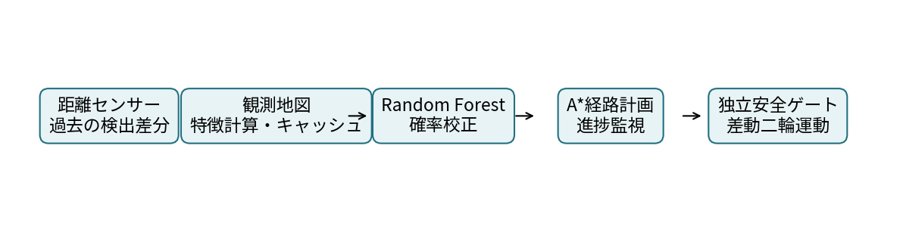
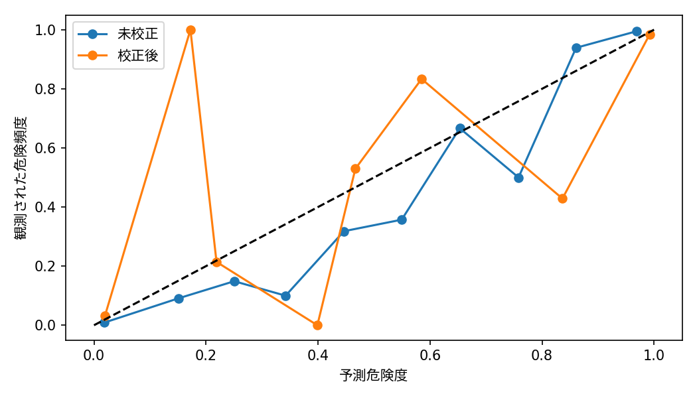
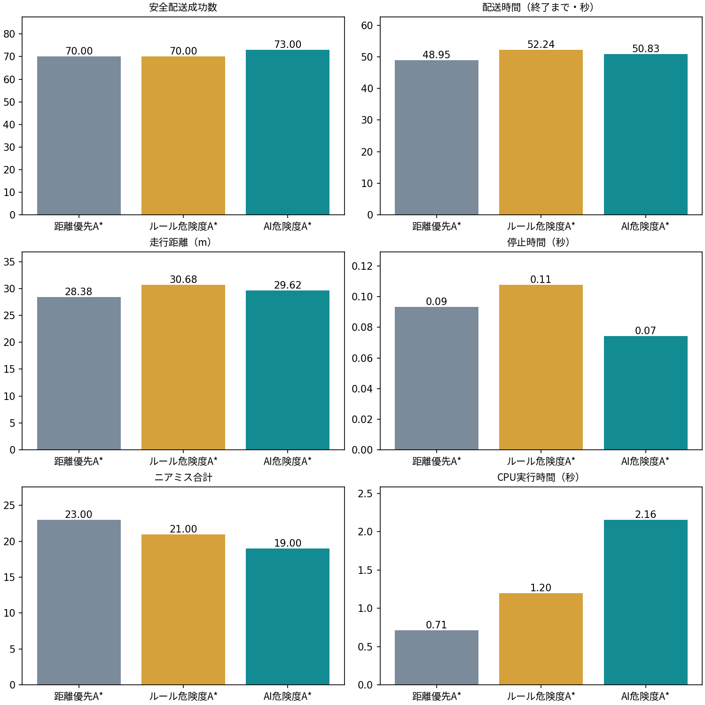
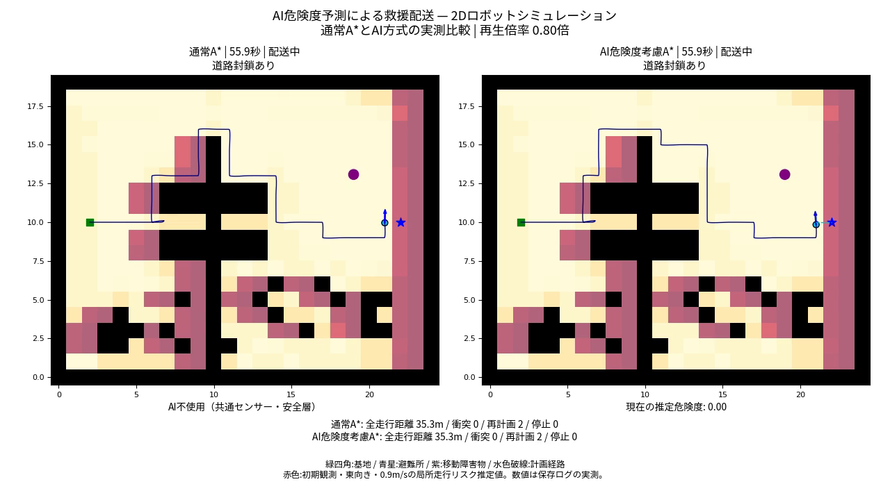

# AI危険度予測による災害救援物資の自律配送ロボット

## 1. 目的とシステム

災害現場を模した2D環境で、救援基地から避難所へ物資を配送する。AIが推定する局所衝突リスクを経路選択へ反映し、距離優先・ルール危険度・AI危険度の3方式を公平に比較する。CPU上のPython 3.12で動作し、GPU、外部API、ROS 2は使用しない。

## 2. ロボットと環境

25×20セル、1セル1m、基地(2,10)、避難所(22,10)。半径0.20m、車輪間隔0.40mの差動二輪ロボットを0.1秒刻みで積分する。最大速度0.9m/s、加速度1m/s²。全周32方向・最大5mの距離センサーで観測し、移動物体の速度は過去の検出差分から求める。静的初期地図と自己位置は既知とする。

既存のbasic・shortcut・dynamicを維持し、交差する移動物体、全域の瓦礫、未知の壁位置・通路位置と道路封鎖を含むcrossing・clutter・closureを追加する。障害物の軌跡は方式に依存せず固定する。

## 3. 学習と確率校正

学習24シナリオ0–23、モデル選択6シナリオ40–45、確率校正6シナリオ60–65を分離し、各150候補を用いる。候補位置から1.5秒直進する局所走行を模擬し、障害物表面まで0.38m未満となる場合を危険とする。入力は壁距離、通路幅、観測物体との距離・接近速度・前方位置・横距離、速度、方向cos/sin、前方地図距離の10成分。

Random Forestは80木、乱数42、最小葉4、深さ8/12を検証F1で選択する。isotonic回帰は独立した校正データで学習し、検証Brier scoreで採否を決める。分類テスト100–105は過去にも評価済みの診断集合であり、新しい未知配送環境とは区別する。

診断テスト900件：ROC AUC 0.9903、PR AUC（average precision）0.9744、F1 0.9215、適合率 0.9738、再現率 0.8745、Brier score 0.0313。分類精度を配送成功確率として解釈しない。

## 4. 経路選択と自律復帰

距離方式の辺コストは1。ルール方式は同じ特徴量から壁近接と動的接近を評価する。AI方式は 1 + 2.0 × max(0, p−0.4) / (1−0.4) を使用する。危険確率の低い領域で過剰な迂回コストを加えない。重みと閾値は配送検証seed 700・701の6環境で固定し、最終評価後は調整しない。辺コストは1以上で、マンハッタン距離は許容的である。これは局所リスクの加算コストであり、経路全体の衝突確率ではない。

観測速度による2.5秒等速予測領域を全方式で一時通行禁止とする。新しい壁や接近を検知したら再計画し、3秒間に0.15m進まなければ先頭経路を一時回避する。迂回不能なら元の条件へ戻す。静的特徴だけをキャッシュし、新しい壁を観測したら無効化する。動的特徴は再計算する。小さな推論はCPUの1スレッドで実行する。

## 5. 独立した安全制御

近接、次の移動区間の静的・動的障害物、古い観測・指令、非有限値、モデル異常を監視し、AIに依存せず停止する。従来の閾値は緩和しない。停止中のロボットへ物体が進入する場合は衝突を防げず、評価器は接触を検出して失敗終了する。安全停止は理想即時停止であり実機のブレーキを保証しない。

## 6. 未知配送ベンチマーク

crossing・clutter・closure各30組、seed 10000–10029、hard、180秒制限を事前固定した。90組のうち60組は動的環境。全3方式で同じ地図・物体・センサー・安全制御を使用する。安全配送は時間内成功かつ衝突・ニアミス0と定義する。失敗を除外した時間平均は使わず、失敗時の終了までの値と、失敗を180秒として扱う制限時間付き指標を記録する。

距離優先A*：配送成功 72/90、安全配送 70/90、衝突 18、ニアミス 23。平均終了時間 48.95秒、距離 28.38m、停止時間 0.09秒、CPU実行時間 0.711秒。

ルール危険度A*：配送成功 77/90、安全配送 70/90、衝突 13、ニアミス 21。平均終了時間 52.24秒、距離 30.68m、停止時間 0.11秒、CPU実行時間 1.196秒。

AI危険度A*：配送成功 74/90、安全配送 73/90、衝突 15、ニアミス 19。平均終了時間 50.83秒、距離 29.62m、停止時間 0.07秒、CPU実行時間 2.156秒。

## 7. 結果の解釈

AI−距離優先の制限時間付き配送時間差は-2.581秒、95%区間は[-8.056, 2.811]。安全配送率差は3.33ポイント、95%区間は[-1.11, 8.89]ポイント。

AIが距離方式を上回る項目があっても、ルール方式との比較も必要である。成功率の低下や未達目標を隠さず、図と全試行の数値で判断する。移動物体の進入による失敗は、局所直進ラベルと等速予測の限界を示す。単にAIを使うだけでは配送性能は保証されない。

## 8. 要素別評価と制約

独立した開発seed 800・801で、危険度重み0、未校正、低リスク域抑制なし、選択済み方式を比較する。全試行はablations.jsonに記録する。速度制御・安全層・進捗監視は全方式で共通であり、その改善をAI単独の効果とは主張しない。速度調整・再計画最適化の個別アブレーションは実施していない。

推論実時間は測定するがシミュレーション時刻へ遅延として加えていないため、実時間制御性能は主張しない。合成データ、理想的な分類・自己位置、有限の地図分布、未モデル化の滑りや通信遅延が制約である。95%区間は固定集合内の対ブートストラップで、他環境への安全保証ではない。

## 9. 動画と再現方法

デモは事前規則「closureの最小最終評価seed 10000」に従って選び、結果を見て選別しない。実測走行を左右同時刻で比較し、危険度、再計画、道路封鎖、配送結果を表示する。OP・EDは提供素材を保持する。素材には音声がないため完成MP4には無音AACを付ける。再生倍率は表示のみで、制御精度を変更しない。

学習はscripts/train_improved.py、配送評価はscripts/benchmark.py、図表・原稿はscripts/publish_results.py、動画はscripts/build_submission.py、PDFはscripts/generate_report.pyで生成する。設定、データ・モデルハッシュ、Gitコミット、依存は環境記録に保存する。

## 10. 結論

局所走行に基づく危険度学習、独立安全層、進捗監視を備えた配送シミュレーションを実装した。AIによる効果は、固定した未知環境で距離方式とルール方式の両方と比較して評価する。未達の指標や失敗事例も含む実測値が結論の範囲である。

## 11. 結論の範囲

安全配送は距離優先70/90、ルール70/90、AI73/90。AIの安全配送率差は3.33ポイントだが95%区間は0を含む。5ポイント改善目標は未達。失敗を180秒とする平均は距離方式76.22秒、AI73.64秒で、5%短縮目標も未達。ニアミスは23件から19件、停止時間は平均0.093秒から0.074秒へ減った。これらは観測値の改善であり、一般的な優位性や安全保証を示さない。ルール方式は配送成功数と衝突数でAIを上回る。

## 12. 要素別の実測値（独立開発集合）

selected：6走行、成功4、衝突2、ニアミス2、平均終了時間36.23秒。

weight_zero：6走行、成功4、衝突2、ニアミス2、平均終了時間35.13秒。

uncalibrated：6走行、成功4、衝突2、ニアミス2、平均終了時間45.75秒。

floor_zero：6走行、成功5、衝突1、ニアミス2、平均終了時間49.00秒。

条件ごとの結果だけから単一要素の普遍的優位性を判断しない。最終配送評価はこの比較に使っていない。ルール方式の重みはAIと同じ2で、独立した最適化は実施していない。

## 13. 既存環境の回帰比較

変更前コミット8ed8b58と同じ6走行のAI比較では、配送成功は両方6/6、ニアミスは2件から0件、平均配送時間は48.40秒から46.05秒、CPU実行時間は7.76秒から1.83秒となった。これは既存分布の少数回帰確認であり、未知90組の結果と混同しない。CPU時間は同時実行負荷に依存する。

確率校正の検証Brier score：未校正0.0445、校正後0.0418。校正を分類F1や配送成功率の向上と同一視しない。

選択済みAIモデルは最終90組のうち58組で距離方式と異なる初期経路を選んだ。これはログで確認した経路への寄与であり、安全性向上を意味するものではない。

