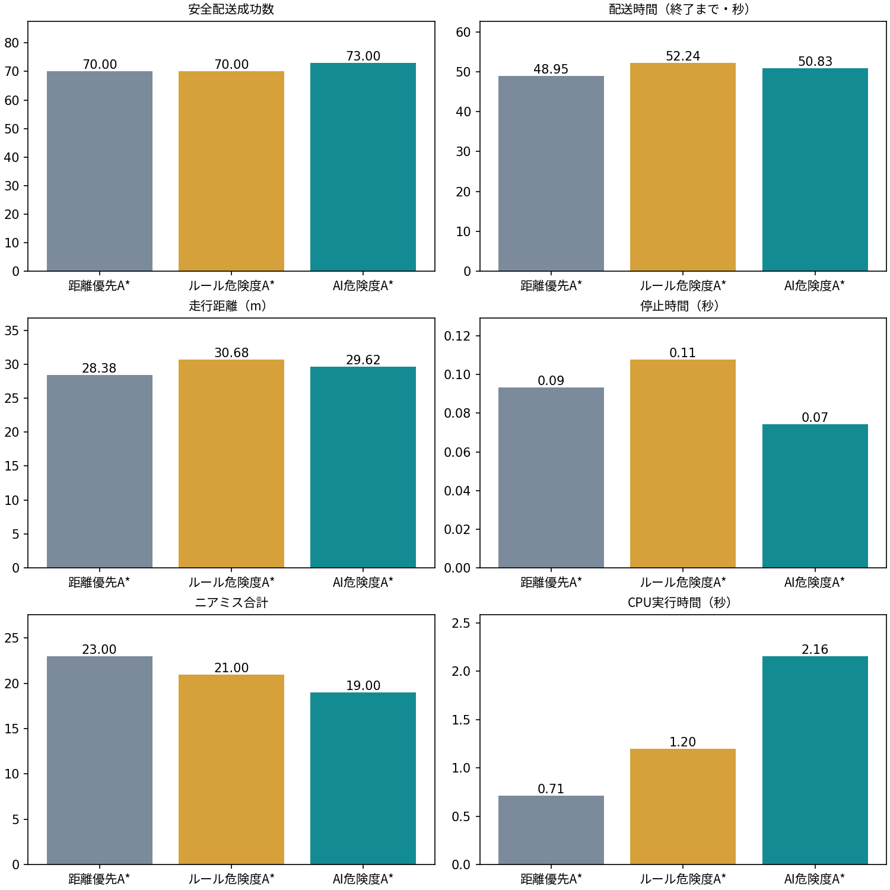

# 未知環境の対比較結果

crossing・clutter・closure各30組、seed 10000–10029、hard、180秒制限。3方式×90組=270走行。安全配送は成功かつ衝突・ニアミス0。失敗例を除外しない。

|指標|距離優先|ルール危険度|AI危険度|
|---|---:|---:|---:|
|成功数 / 90|72.000|77.000|74.000|
|安全配送数 / 90|70.000|70.000|73.000|
|衝突合計|18.000|13.000|15.000|
|ニアミス合計|23.000|21.000|19.000|
|終了までの平均時間s|48.948|52.240|50.834|
|平均距離m|28.383|30.680|29.618|
|平均停止時間s|0.093|0.108|0.074|
|平均再計画|4.122|4.733|4.467|
|平均最小余裕m|0.203|0.493|0.229|
|平均推論合計ms|0.000|110.476|1032.690|
|平均計画合計ms|0.825|323.560|350.063|
|平均CPU実行時間s|0.711|1.196|2.156|

AI−距離優先の制限時間付き配送時間差：-2.581秒、対ブートストラップ95%区間 [-8.056, 2.811]。失敗は180秒とする。安全配送率差：3.33ポイント、95%区間 [-1.11, 8.89]ポイント。区間は固定ベンチマーク内の標本不確実性で、別分布への保証ではない。

全試行はbenchmark_results.csv / benchmark_results.json。gzip走行ログはoutputs/final/benchmark/logs。分類テストの性能と配送性能は区別する。ルール方式がAI方式を上回る場合もそのまま記載する。

安全配送は距離優先70/90、ルール70/90、AI73/90。AIの安全配送率差は3.33ポイントだが95%区間は0を含む。5ポイント改善目標は未達。失敗を180秒とする平均は距離方式76.22秒、AI73.64秒で、5%短縮目標も未達。ニアミスは23件から19件、停止時間は平均0.093秒から0.074秒へ減った。これらは観測値の改善であり、一般的な優位性や安全保証を示さない。ルール方式は配送成功数と衝突数でAIを上回る。
