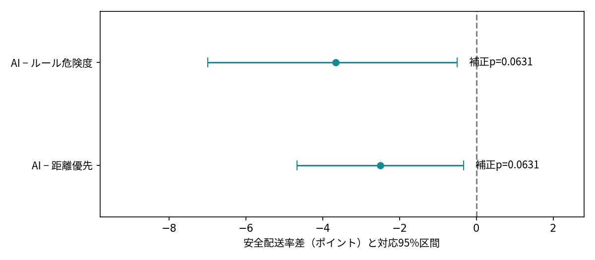

# 固定600組の対比較結果

全600組・3方式・1800走行。各シナリオ200組、180秒制限。失敗を含む。安全配送＝時間内成功かつ衝突・ニアミス0。

|指標|距離優先|ルール危険度|AI危険度|
|---|---:|---:|---:|
|配送成功|478.000|494.000|469.000|
|安全配送|463.000|470.000|448.000|
|衝突合計|115.000|104.000|127.000|
|ニアミス合計|137.000|133.000|161.000|
|終了までの平均時間s|50.028|49.218|48.273|
|失敗180秒の平均配送時間s|77.781|74.357|78.336|
|平均距離m|28.777|28.347|28.008|
|平均停止時間s|0.072|0.319|0.089|
|平均プロセスCPU時間s|0.989|1.548|2.613|
|並列実行中の平均壁時計時間s|1.041|1.616|2.727|
|平均再計画|4.638|5.035|4.577|

AI対距離方式：安全配送率差 -2.50ポイント、95%区間 [-4.67, -0.33]。AIだけ安全配送 15組、相手だけ安全配送 30組。正確McNemar両側p=0.0356978、Holm補正p=0.0630962。事前基準では当該比較の優位性を支持できなかった。同等性の証明ではない。
AI対ルール方式：安全配送率差 -3.67ポイント、95%区間 [-7.0, -0.5]。AIだけ安全配送 37組、相手だけ安全配送 59組。正確McNemar両側p=0.0315481、Holm補正p=0.0630962。事前基準では当該比較の優位性を支持できなかった。同等性の証明ではない。

表示した95%区間は各比較の周辺区間で同時区間ではない。区間が0を含まなくても、Holm補正pが0.05以上なら事前の優位性基準を満たさない。

95%区間は各シナリオ内の対応を維持する5,000回のブートストラップ（乱数426）。検定の2比較へHolm補正を適用。時間などの副指標は探索的な記述評価で、主指標の代わりに結論へ使わない。

